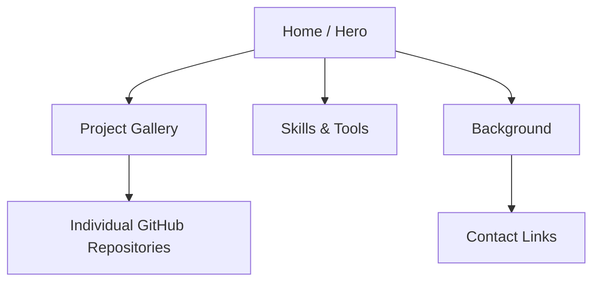

<p align="center"></p>

<div align="center">

<h2>shanmukhkoyya.github.io</h2>
<a href="https://shanmukhkoyya.github.io"></a>
<p>Static site · HTML · CSS · JavaScript · GitHub Pages</p>
</div>

## Site map


## Page component matrix
| Component | Visitor task |
|---|---|
| Hero | Understand role focus and navigate |
| Project cards | Browse analytics work |
| Skills | Review tools and workflow |
| Background | Review training and education |
| Contact | Open professional links |

## Technology stack
<p align="center">   </p>

## Run locally
```bash
git clone https://github.com/shanmukhkoyya/shanmukhkoyya.github.io.git
cd shanmukhkoyya.github.io
# Open index.html in a modern browser
```
No package manager or build step is required.

## Release checklist
- [ ] Test mobile layout and navigation.
- [ ] Check keyboard focus and skip link.
- [ ] Verify project URLs and alt text.
- [ ] Match displayed metrics to source projects.
- [ ] Label conceptual artwork clearly.

> Project-card artwork is illustrative, not a screenshot exported from Power BI. Open each source repository for its files and evidence.