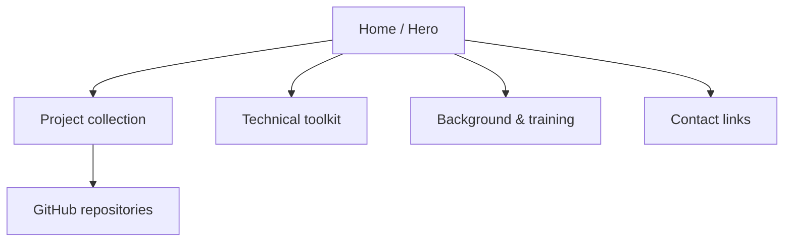

<div align="center">

<h1>THE PORTFOLIO SITE</h1>
<p><b>A responsive front door to analytics work</b></p>
<a href="https://shanmukhkoyya.github.io"></a>
</div>

## Site map


## Page zones
| SCREEN AREA | VISITOR PURPOSE | DESIGN ELEMENT |
|---|---|---|
| Landing | Understand the profile quickly | Hero and navigation |
| Projects | Find work samples | Project cards |
| Skills | Scan tools and focus | Skill groups |
| Background | Review training | Education and credentials |
| Contact | Continue the conversation | Professional links |

## Technology stack
<p align="center"></p>

## Run locally
```bash
git clone https://github.com/shanmukhkoyya/shanmukhkoyya.github.io.git
cd shanmukhkoyya.github.io
```
Open `index.html` in a browser. No package install or build step is required.

## Publish checklist
- [ ] Check mobile, tablet and desktop layouts.
- [ ] Test keyboard navigation and visible focus.
- [ ] Verify all project and contact links.
- [ ] Recheck every displayed metric against its source.
- [ ] Keep conceptual artwork clearly labelled.

> The project artwork is illustrative and is not a Power BI screenshot export.