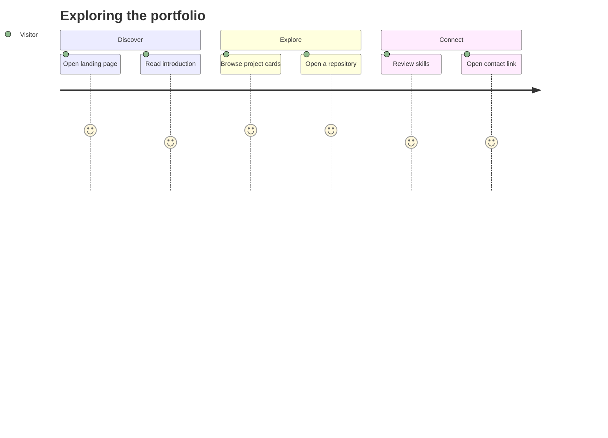

<div align="center">

# THE PORTFOLIO SITE
### A small, responsive home for analytics projects

<a href="https://shanmukhkoyya.github.io"></a>
</div>

## Visitor journey



## The page, mapped

| Zone | What it does | Primary element |
|:--|:--|:--|
| **01 / Hero** | Establishes profile and navigation | Intro panel |
| **02 / Work** | Directs visitors to project evidence | Project cards |
| **03 / Toolkit** | Shows technical focus | Skills section |
| **04 / Background** | Summarises training and education | Profile details |
| **05 / Contact** | Provides professional destinations | External links |

## Under the hood

<p align="center">


</p>

## Run it locally

```bash
git clone https://github.com/shanmukhkoyya/shanmukhkoyya.github.io.git
cd shanmukhkoyya.github.io
```

Open `index.html` in a modern browser. No package manager or build command is required.

## Release gate

- [ ] Check the layout at mobile and desktop widths.
- [ ] Navigate using keyboard only.
- [ ] Verify internal and external destinations.
- [ ] Confirm every displayed metric against its project.
- [ ] Keep conceptual artwork labelled as conceptual.

> **Evidence note:** Project-card artwork is illustrative. It is not a screenshot exported from Power BI Desktop.